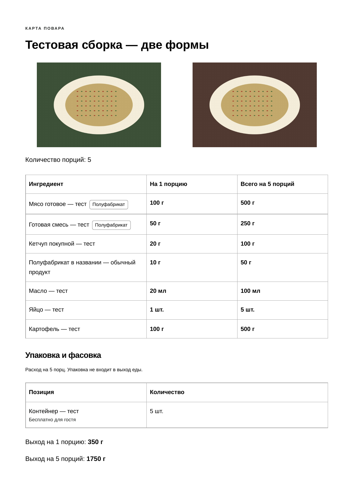
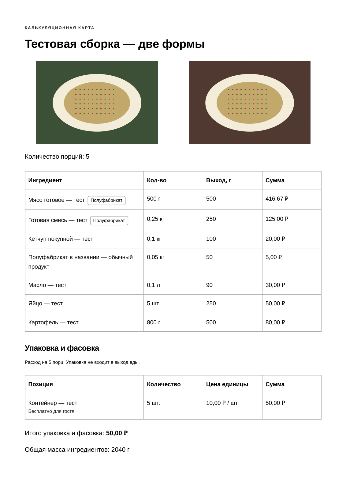
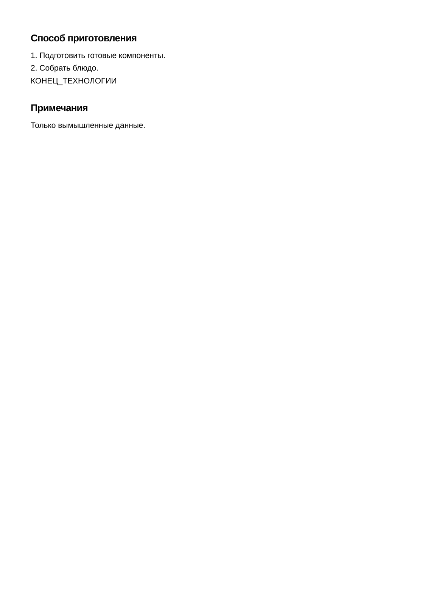
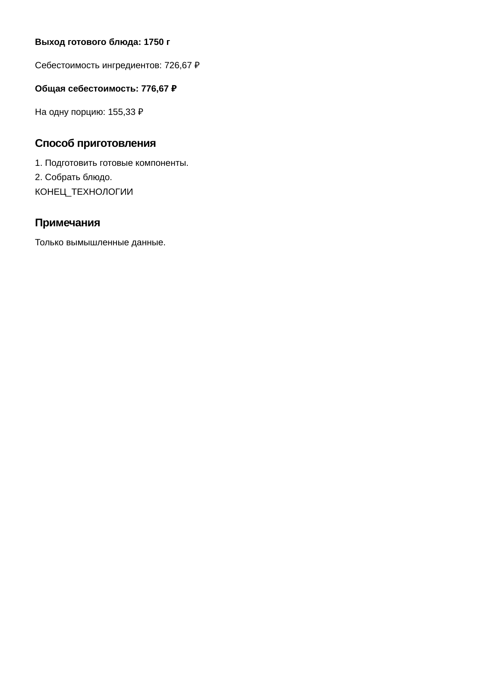
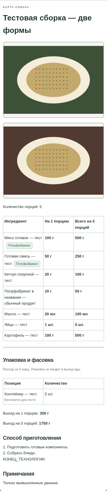
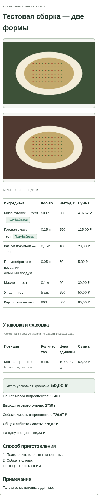

# Карта повара и калькуляционная карта

Один сохранённый рецепт теперь можно открыть в двух формах. Новые блюда или отдельные базы для форм не создаются. Доработка подготовлена в `feature/recipe-card-modes` только тестового репозитория, поверх открытого PR №10 с двумя фото и черновиками. PR №10, main и настройки Pages не изменяются; объединение и публикация не выполняются автоматически.

## Как пользоваться

1. Откройте сохранённое блюдо в «Моих рецептах». В **«Форма карты»** выберите **«Карта повара»** или **«Калькуляционная карта»**.
2. Укажите количество порций. В карте повара всегда есть расход **на одну порцию**; при нескольких порциях дополнительно показан общий расход. В калькуляционной карте количества и суммы относятся к выбранному количеству порций.
3. В **«Фотографии при печати»** выберите **«Без фотографий»**, **«Только первая»**, **«Только вторая»** или **«Обе фотографии»**. Для каждой формы можно выбрать своё сочетание. На экране остаются оба снимка; настройка не удаляет их из рецепта.
4. Нажмите **«Печать»** и выберите A4. Кнопки, навигация, пустые и невыбранные фоторамки не печатаются. Если выбрана пустая позиция, карта печатается без изображения и без пустого фотоблока.
5. Вернитесь к другой форме: её выбор фото сохранится до закрытия/обновления страницы. Для изменения самого рецепта нажмите «Изменить», затем обычное «Сохранить».

Выбор формы, количества для просмотра и фото не изменяет рецепт, фотографии, черновики или JSON. После перезапуска браузера сохранённые рецепты и фото остаются; настройки представления возвращаются к начальным.

## Что показывает каждая форма

| Данные | Карта повара | Калькуляционная карта |
| --- | --- | --- |
| Название и количество порций | Да | Да |
| Пищевые ингредиенты | Готовое количество на 1 порцию; при необходимости общий расход | Сохранённое количество сырья и расчётный выход |
| Единицы | г, мл, шт.; кг → г, л → мл | Прежние единицы рецепта |
| Отметка «Полуфабрикат» | По связи с объектом type=prep | Та же отметка |
| Закупочные/расчётные цены, суммы и себестоимость | Нет | Прежние показатели, включая стоимость одной порции |
| Масса сырья и расчётные колонки выхода | Нет | Да |
| Упаковка | Количество без финансовых данных | Количество, цена и стоимость |
| Фото при печати | Независимый выбор 0/1/2 снимков | Независимый выбор 0/1/2 снимков |

Существующие заполненные технология и примечания по-прежнему выводятся. Пустые разделы не создаются. Третья отдельная форма «Технология приготовления» сейчас не добавлена.

## Готовая масса и полуфабрикаты

Если у блюда записано 100 г готового мяса, связанного с полуфабрикатом, карта повара показывает **100 г**. Масса сырья и потери производства этого полуфабриката повторно не применяются. Состав вложенной заготовки в основной таблице не раскрывается.

Пример: партия содержит 1000 г сырого мяса за 500 ₽, выход — 600 г готового. 100 г готового компонента стоят 83,33 ₽ по прежней формуле. В карте повара остаются 100 г и отметка «Полуфабрикат»; в калькуляционной сохраняются стоимость и выход. Если рецепт на 5 порций содержит 500 г этой заготовки, повар видит 100 г на порцию и 500 г всего.

Отметка определяется по ID связанного сохранённого объекта. Покупной кетчуп и продукт со словом «полуфабрикат» в названии не получают её автоматически. Объём и штуки не переводятся в массу без причины: 20 мл масла остаются 20 мл, яйцо — 1 шт., даже если известен коэффициент массы.

Когда обработка задана прямо у пищевого продукта, готовое количество берётся из существующего расчётного выхода: 160 г картофеля с выходом 100 г отображаются повару как 100 г. Калькуляционная форма сохраняет 160 г сырья и 100 г выхода. Неизвестное количество помечается «Не задано»; отсутствие цены не скрывает известную готовую граммовку.

## Надёжность и архитектура

- Используются прежние `recipes`, поля фотографий и черновиков. Версия JSON, localStorage и IndexedDB не менялись; миграция не нужна.
- `recipe-card-model.js` подготавливает только данные отображения через существующий `KitchenRecipeView.scale`; `recipe-card-templates.js` содержит отдельные шаблоны форм. Расчётные формулы продуктов, полуфабрикатов, блюд и упаковки остаются в прежних модулях без изменений.
- Шаблоны и список форм можно расширить в будущем без создания другой базы рецептов. Новые поля шагов, времени, температуры, видео и третья форма пока не реализуются.
- Галерея не пересоздаёт фото при смене формы или количества порций. Для печати проверяется готовность только выбранных снимков: ошибка второго не мешает печатать исправный первый или карту без фото.
- Неверное количество порций блокирует печать и скрывает прежнюю карту до исправления, чтобы она не выглядела актуальной и не показывала старые цены после выбора карты повара.
- Экспорт/импорт, восстановление черновиков и оба фото сохранены. Настройки формы и печати в основной JSON не записываются, дубликаты рецепта не создаются.

## Образцы A4 и ручная приёмка

Все образцы созданы из настоящей печати Chromium на локальном сервере, с вымышленными продуктами и синтетическими изображениями блюда. Это не фотографии пользовательских данных. Рецепт с фото и технологией занимает две заполненные страницы; пустых страниц нет.

- [Карта повара, PDF целиком](print/card-modes/chef-both.pdf).
- [Калькуляционная карта, PDF целиком](print/card-modes/calculation-both.pdf).
- [Протокол восьми сочетаний формы и фото](screenshots/card-modes/print-proof.json).

| Карта повара — страница 1 | Калькуляционная карта — страница 1 |
| --- | --- |
|  |  |

| Карта повара — страница 2 | Калькуляционная карта — страница 2 |
| --- | --- |
|  |  |

| На телефоне: карта повара | На телефоне: калькуляция |
| --- | --- |
|  |  |

При ручной проверке сравните 100 г готового компонента в обеих формах, обычный кетчуп без отметки, все четыре выбора фото, прежние суммы, восстановление после закрытия браузера и перенос JSON. Реальный Android, другие браузеры и физический принтер требуют отдельной проверки; успешно выполненная проверка на этих устройствах не заявляется. Сайт Pages в этом задании не публикуется, поэтому прежний адрес пока не показывает эту ветку.
