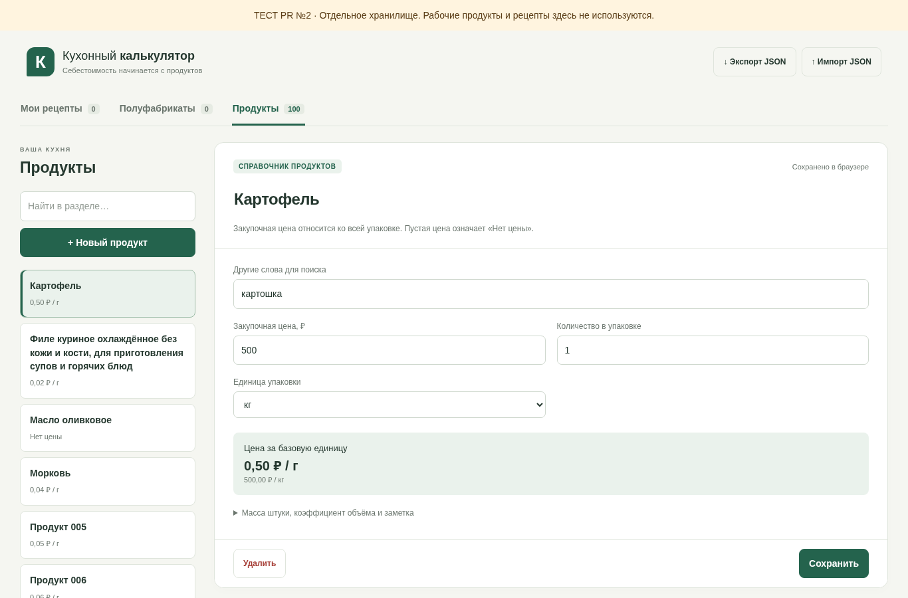
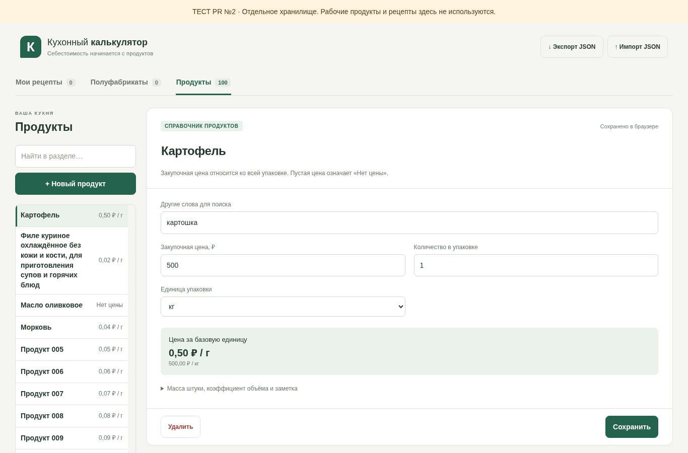
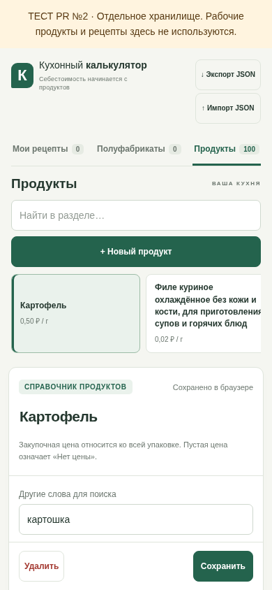
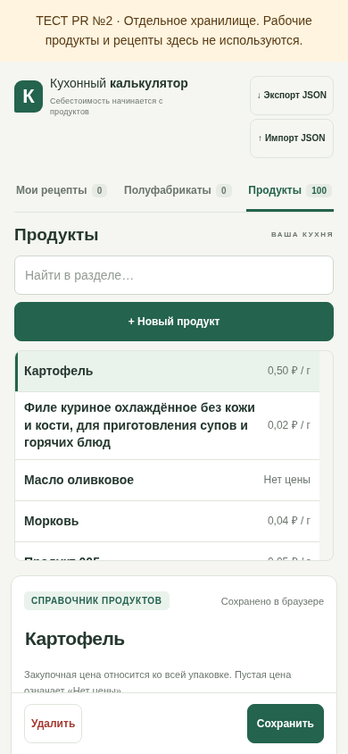

# Issue №4: компактный список продуктов

Изменения предназначены только для `sobaca0808-bit/kitchen-calculator-test`. Рабочий калькулятор, его репозиторий, настройки публикации и PR №2 не меняются. Этот PR не объединяется и не публикуется автоматически.

## Что изменилось

В разделе «Продукты» название и прежняя цена за базовую единицу находятся в одной строке: название слева, цена или «Нет цены» справа. Обычные строки имеют высоту не меньше 44 px (46 px на мобильных экранах), название — 14 px, цена — 12 px. Длинное название полностью переносится; многоточием оно не заменяется. Крупная цена также переносится внутри своей ячейки.

Список ограничен по высоте и прокручивается вертикально внутри панели. Поиск и «+ Новый продукт» находятся снаружи списка, поэтому внутренняя прокрутка их не уводит. На широком экране ширина колонки продуктов уменьшена с 264 до 240 px; форма справа получает больше места. На телефоне список ограничен примерно четвертью высоты экрана.

Выбранная строка выделена цветом и помечена `aria-current`; обычные кнопки работают с Enter/Space, а фокус и положение прокрутки сохраняются при выборе строки. Сам список также доступен с клавиатуры как именованная область прокрутки.

Разделы «Полуфабрикаты» и «Мои рецепты» сохраняют прежнюю компоновку. Расчёты, значения цен, ключ localStorage, импорт/экспорт JSON, формы, техкарты и печать не меняются.

## Скриншоты до/после

Одинаковые 100 вымышленных продуктов, новый временный контекст браузера для каждого снимка. «До» — тестовый `main`, commit `3dd4bfe`; «после» — ветка этого PR. Изображения сняты локально в Chromium, это не снимки внешней публикации.

ПК, 1366 × 900:

| До | После |
| --- | --- |
|  |  |

Телефон, 390 × 844:

| До | После |
| --- | --- |
|  |  |

Для 100 продуктов высота списка на ПК стала 520 px вместо 8092 px; весь длинный справочник доступен внутренней прокруткой. На мобильном снимке высота списка 234 px. Общая высота страницы по-прежнему зависит от существующей формы справа/снизу, но не от сотен строк справочника.

## Как проверить владельцу

До одобрения PR существующий сайт не обновляется этим изменением. Скриншоты и локальные автоматические проверки доступны в PR. После одобрения и публикации владельцем проверять нужно только тестовый адрес, с отметкой «ТЕСТ PR №2».

1. На ПК откройте «Продукты». Проверьте название и цену, выделение выбранной строки, внутреннюю прокрутку. При прокрутке списка поиск и добавление должны оставаться на месте.
2. Найдите продукт по названию или синониму, откройте его. Создайте вымышленный продукт, сохраните дважды, затем измените и снова откройте: запись должна остаться одна.
3. На телефоне повторите поиск и выбор. Проведите пальцем внутри списка до последнего продукта. Страница не должна прокручиваться горизонтально; длинные названия должны читаться полностью.
4. Переключитесь на полуфабрикаты и блюда: их оформление, карточки и печать должны остаться прежними.

Не нужно загружать рабочие резервные копии или очищать хранилище браузера. Списки из 12, 100 и 500 продуктов проверяются автоматически на вымышленных данных, без замены записей владельца.

Для повторения проверок: `node scripts/check-preview.mjs` с установленными Playwright и Chromium, как описано в PREVIEW.md. Команда поднимает временный локальный сервер и использует отдельные браузерные контексты. Проверки опубликованного сайта и настоящего Android-устройства в этой среде не заявляются.
