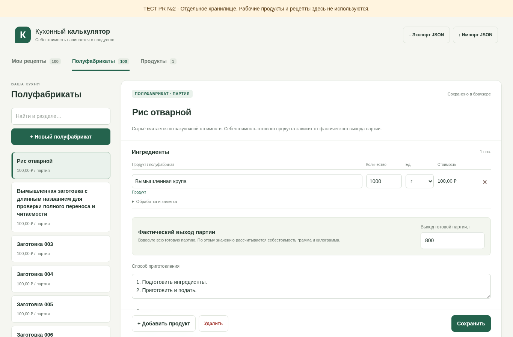
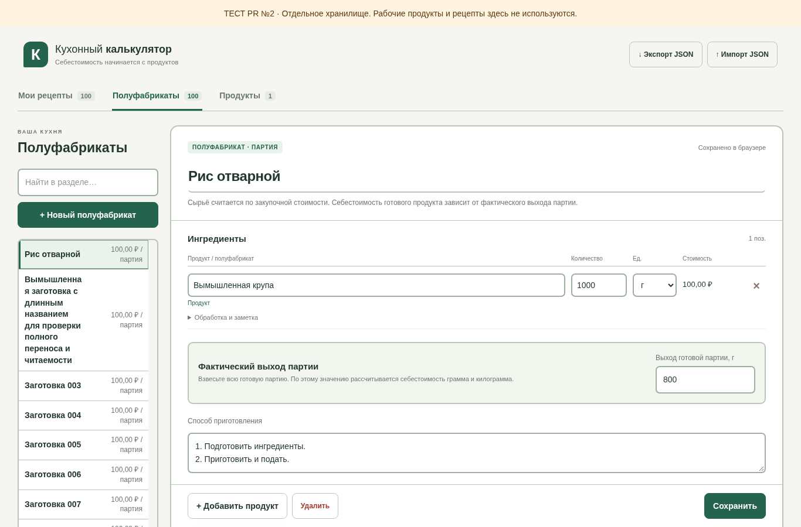
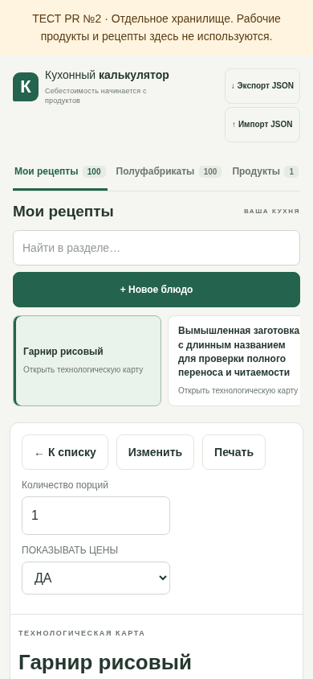
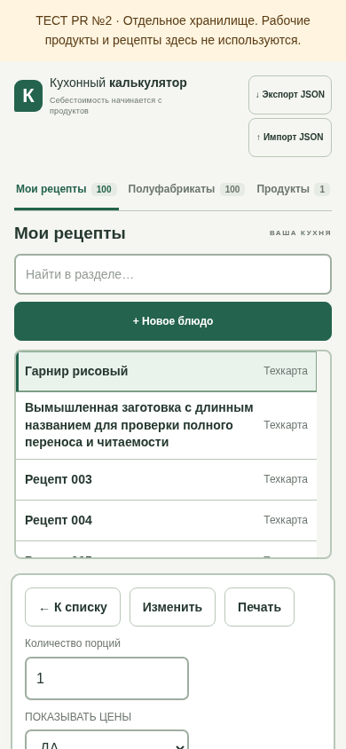

# Issue №6: общий компактный справочник и заметные контуры

Ветка предназначена только для `sobaca0808-bit/kitchen-calculator-test` и основана на открытом PR №5. В этом PR показаны только следующие изменения относительно PR №5; он не объединяет PR №5 и не обновляет main или публикацию автоматически.

## Изменения

«Продукты», «Полуфабрикаты» и «Мои рецепты» используют общий компонент списка: компактная строка, полное название слева, краткая подпись справа, ограниченная высота, внутренняя вертикальная прокрутка. Поиск и добавление находятся над прокручиваемой областью. Длинные названия переносятся без обрезания. На телефоне высота списка адаптируется к экрану.

Все списки доступны клавиатурой. Выбранная строка выделена, фокус и положение прокрутки сохраняются после выбора. Подпись «Техкарта» в списке блюд заменяет длинное повторяющееся приглашение открыть карту. Действия остались прежними: блюдо открывается в просмотре, редактирование — отдельно; полуфабрикат открывается в существующем редакторе.

На экране внешние границы карточек, списков, полей, панелей выхода и итогов стали 2 px. Серо-зелёные оттенки немного темнее, общая палитра сохранена. Крупное поле названия получило заметное подчёркивание. Обычное, выбранное и фокусное состояния различимы; ошибки числового ввода остаются красными.

Изменения контуров ограничены `@media screen`. Прежние настройки A4 и таблицы в печати не меняются. Формулы, ингредиенты, цены, JSON, сохранение и отдельный тестовый ключ localStorage не менялись. Enter для сохранения, упаковка, фото и новые варианты печати не добавлены.

## Скриншоты

Одинаковые вымышленные данные: по 100 полуфабрикатов и блюд, свежий браузерный контекст для каждого снимка. «До» — PR №5, commit `ba5a926`; «после» — эта ветка. Это локальный Chromium, не внешняя публикация.

ПК 1366 × 900, полуфабрикаты:

| До | После |
| --- | --- |
|  |  |

Телефон 390 × 844, мои рецепты:

| До | После |
| --- | --- |
|  |  |

## Ручная проверка владельцем

До одобрения PR существующий сайт не обновляется этой веткой. Сначала проверьте PR №5, затем данный PR; ничего автоматически не объединяется. После принятия PR №5 база данного PR при необходимости меняется на main тестового репозитория. Рабочий репозиторий и его Pages для этого не нужны.

1. Поочерёдно откройте три раздела. Проверьте одинаковую компоновку списка и поиск, выбранную строку, внутреннюю прокрутку до последней позиции и полное длинное название.
2. На ПК нажмите Tab: фокус должен быть виден у поля, области списка и строки. Enter/Space на строке выбирает запись; это не новая команда сохранения формы.
3. В полуфабрикате проверьте прежнюю форму; в блюде сначала должна открыться готовая карточка, затем редактор по «Изменить». Сохраните вымышленное изменение и повторно откройте запись.
4. На телефоне повторите выбор и прокрутку внутри списка. Поиск и добавление должны оставаться над ним; горизонтального переполнения быть не должно.
5. Откройте печать блюда с ценами и без них. Утолщённые экранные контуры не должны добавлять рамку вокруг печатной страницы или менять A4.

Тесты 12/100/500 записей используют только вымышленные данные и временные браузерные контексты. Рабочие резервные копии загружать и всё хранилище очищать не нужно. Для полного локального прогона используется прежняя команда `node scripts/check-preview.mjs` с Playwright и Chromium. Настоящее Android-устройство и внешняя публикация этой проверкой не подтверждаются.
