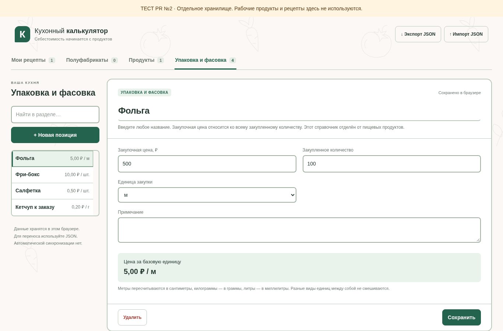
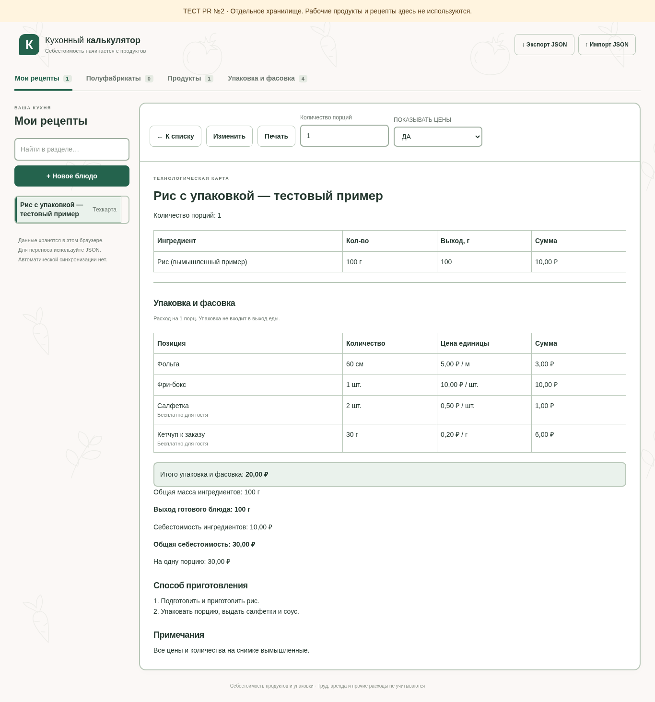
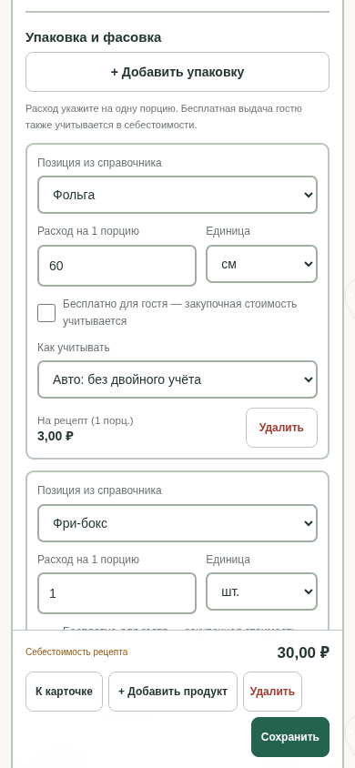
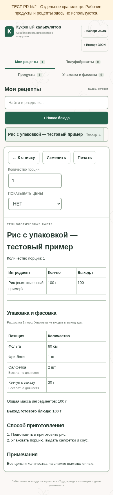

# Issue №7: упаковка, фасовка и спокойный фон

Ветка создана только в `sobaca0808-bit/kitchen-calculator-test` поверх открытого PR №8 (задача №6), который в свою очередь зависит от PR №5. Компактные списки и контуры сохранены. Ничего не объединяется и не публикуется автоматически; рабочий калькулятор и его данные не затрагиваются.

## Как пользоваться

1. Откройте новый раздел **«Упаковка и фасовка»** и нажмите «Новая позиция». Название произвольное: фольга, бокс, салфетка, кетчуп к заказу или другое. Введите цену всей закупки, закупленное количество и единицу. Это отдельный справочник, пищевые продукты в него автоматически не переносятся.
2. В редакторе блюда ниже пищевых ингредиентов нажмите **«Добавить упаковку»**. Можно выбрать несколько разных позиций. Расход всегда задаётся **на одну порцию**, даже если весь рецепт рассчитан на несколько порций.
3. При необходимости отметьте **«Бесплатно для гостя»**. Закупочная стоимость при этом остаётся в себестоимости заведения.
4. Сохраните блюдо и откройте карточку. В ней отдельны пищевые ингредиенты, упаковка, их итоги и полная стоимость. Меняя порции в просмотре, вы временно пересчитываете оба блока; исходная рецептура не перезаписывается.
5. Печатайте с показом цен «ДА» или «НЕТ». Для повара остаются количества и пояснения, но финансовых колонок и итогов нет. Упаковка и добавки из этого блока не входят в массу/выход еды.

Поддерживаются шт., м, см, г, кг, мл, л. Метры ↔ сантиметры, килограммы ↔ граммы и литры ↔ миллилитры пересчитываются внутри одного вида величин. Длина, масса, объём и штуки не смешиваются. Расчёт идёт без промежуточного округления; денежные значения показываются до копеек.

## Контрольные примеры

| Позиция | Закупка | Расход на порцию | Стоимость |
| --- | --- | --- | --- |
| Фольга | 100 м за 500 ₽ | 60 см = 0,6 м | 3 ₽ |
| Фри-бокс | 50 шт. за 500 ₽ | 1 шт. | 10 ₽ |
| Салфетка | 1 шт. за 0,5 ₽ | 2 шт. | 1 ₽ |
| Кетчуп, бесплатно гостю | 1 кг за 200 ₽ | 30 г | 6 ₽ |

Итого — **20 ₽ на порцию**, **200 ₽ на 10 порций**. Если пищевые ингредиенты стоят 10 ₽ на порцию, полная стоимость — 30 ₽ и 300 ₽ соответственно. Увеличение порций не добавляет массу упаковки к выходу еды.

## Защита от двойного учёта

У строки есть три режима:

- **Авто: без двойного учёта.** Первичное совпадение определяется по названию пищевого ингредиента, включая вложенные полуфабрикаты, без регистра, лишних пробелов и различий е/ё. Учитывается только положительный пищевой расход. Совпадение исключается из повторного начисления и сопровождается подсказкой.
- **Дополнительно к ингредиентам.** Выберите, если это отдельная выдача сверх пищевого состава — тогда стоимость прибавляется, даже при совпадении.
- **Уже учтено в ингредиентах.** Явное исключение повтора, в том числе когда одна и та же добавка названа по-разному. Проверьте, что она действительно есть в пищевом составе.

При сохранении/импорте автоматически найденная связь фиксируется по ID ингредиента: последующее переименование продукта или упаковки не начисляет стоимость ещё раз. Если связанный пищевой расход удалён или обнулён, автоматическое исключение прекращается. При выборе другого материала старая связь очищается.

Отсутствующая цена, расход или несовместимая единица помечаются как неполный расчёт. Неверный числовой ввод сохраняется на экране и блокирует сохранение до исправления. Удаление используемой позиции справочника блокируется, пока её не заменят в блюдах.

Этот блок относится к выдаче готового блюда на порцию. Пищевая калькуляция полуфабрикатов остаётся прежней. Импорт с непустой упаковкой у полуфабриката явно отклоняется, чтобы не прятать неучтённые затраты; текущие данные при отказе не заменяются.

## Данные и совместимость

Ключ остаётся `kitchen-calculator-pr2-browser-test-v1`; рабочий `kitchen-calculator-v1` не используется. Версия JSON остаётся 1. Новые поля необязательны: корневой `packaging` — справочник, `recipe.packaging` — расход на порцию с единицей, бесплатной выдачей, режимом учёта и необязательной связью `ingredientRefId`.

Старые рецепты без упаковки импортируются и экспортируются без добавления пустых новых полей. Новые резервные копии сохраняют оба блока. Перед подтверждённой полной заменой при импорте показывается и число позиций упаковки. Повреждённый/неподходящий JSON не заменяет текущие данные; отказ квоты по-прежнему сообщает о данных в памяти и возможности экспорта.

Формулы пищевых продуктов, полуфабрикатов и выхода в `calculations.js` не менялись. Новые материалы не появляются в поиске пищевых ингредиентов. Фото и сохранение по Enter не добавлялись.

## Фон и изображения

За белыми рабочими карточками — светлый фон с редким локальным SVG-паттерном овощей, фруктов, зелени и мяса. SVG занимает менее 2 КБ, не требует внешнего сервиса, не анимируется и не печатается. Белые карточки и поля, контуры и общие компактные списки предыдущего этапа сохранены.

Снимки сделаны локально с вымышленными данными; это не новая внешняя публикация.

Справочник на ПК:

Готовая карта с ценами:

Редактор на телефоне и карточка без цен:

| Редактор | Без цен |
| --- | --- |
|  |  |

## Что проверить владельцу

До одобрения PR существующий сайт остаётся прежним. Сначала проверьте предыдущие PR №5 и №8; этот PR основан на ветке №8. После её принятия при необходимости смените базу текущего PR на main тестового репозитория. Автоматического объединения нет.

На ПК и телефоне создайте четыре вымышленные позиции из таблицы, добавьте их к тестовому блюду и сравните итог 20 ₽ на порцию. Проверьте 10 порций, бесплатный кетчуп, предупреждение о повторе ингредиента, сохранение и повторное открытие, экспорт/импорт тестового JSON, оба режима A4. Рабочие резервные копии для этого не нужны; всё хранилище браузера очищать нельзя.

Автоматические проверки запускаются прежней командой `node scripts/check-preview.mjs` с Playwright и Chromium. Реальный Android, физический принтер и доступность внешнего опубликованного сайта в этом задании не подтверждаются.
