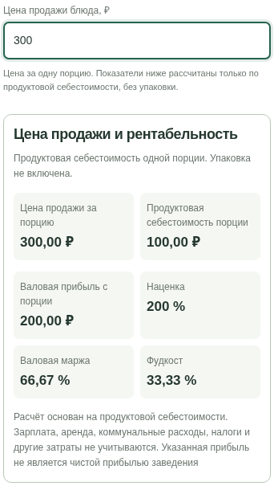
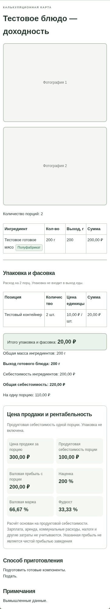
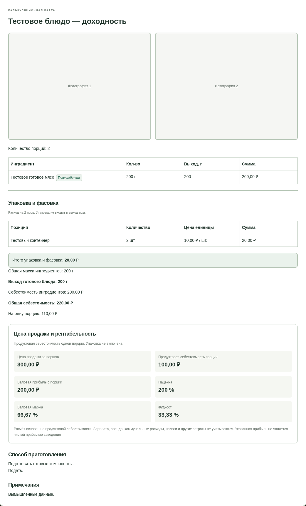
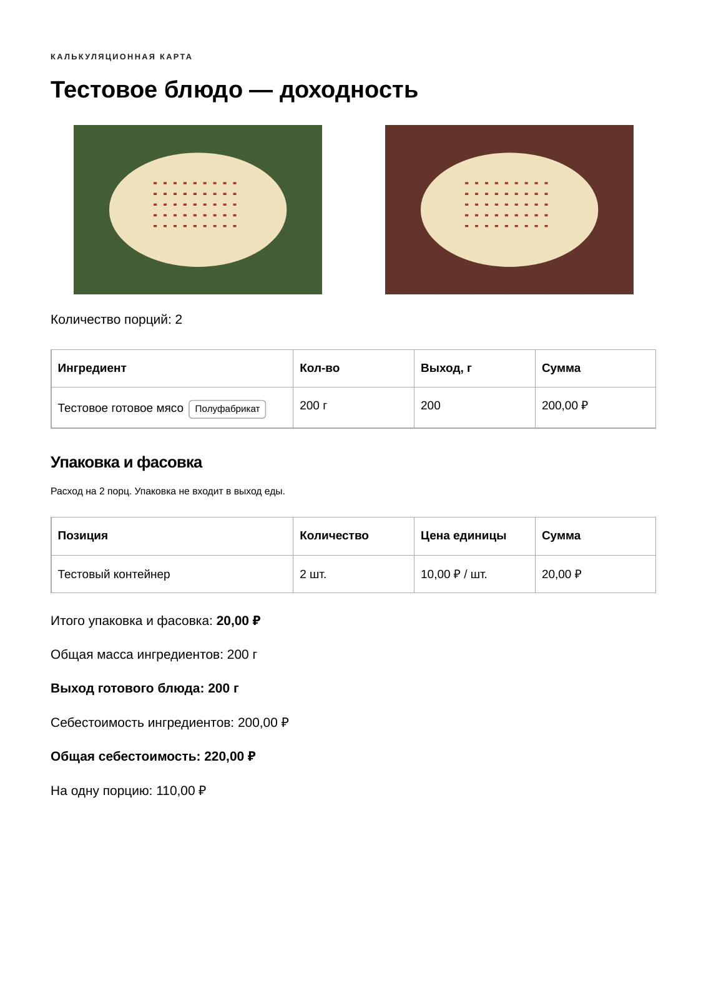
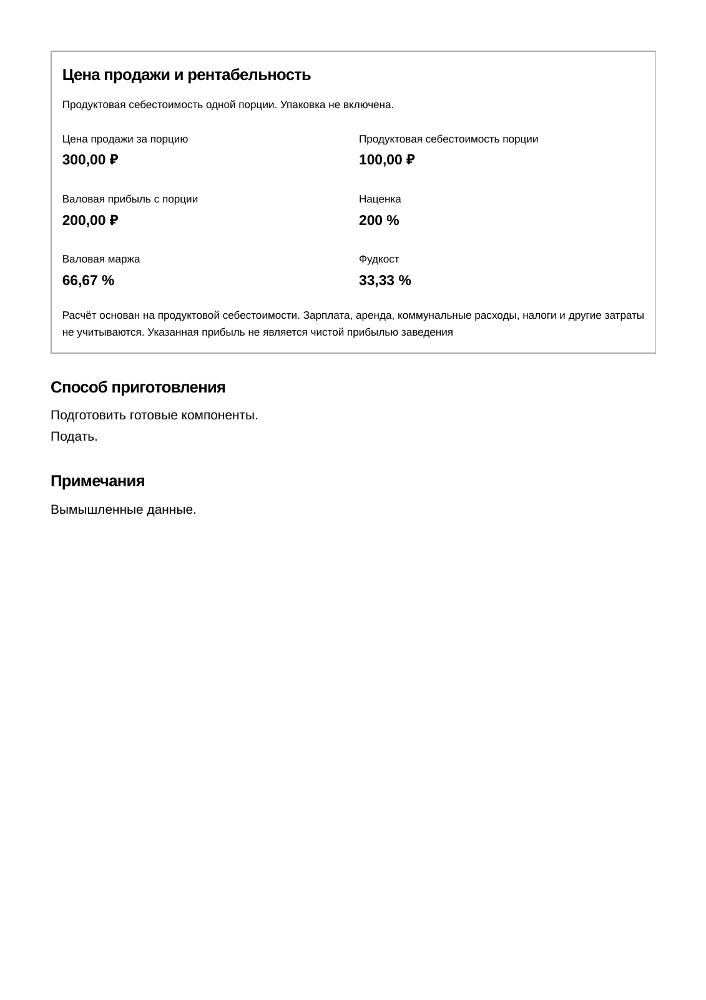
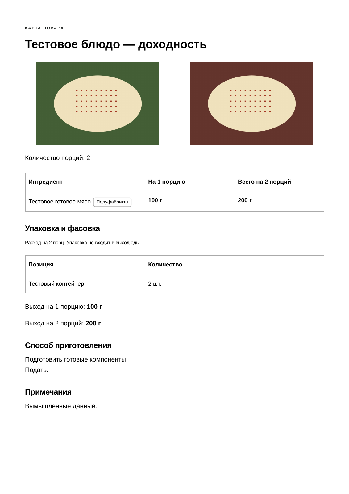

# Задание №12: цена продажи и показатели доходности

Ветка `feature/task-12-selling-price` создана от актуального `main` тестового репозитория — `1c3d87b`. Предыдущие PR, включая №10 и №11, к началу задания уже объединены владельцем. Их функции сохранены. Рабочий репозиторий `kitchen-calculator`, main тестового репозитория и настройки публикации агент не меняет. Новое изменение предлагается отдельным PR, без автоматического объединения и публикации.

## Короткая проверка

1. Откройте блюдо → **«Изменить»**. Ниже калькуляции введите **«Цена продажи блюда, ₽»**. Это цена **одной порции**, даже если рецепт рассчитан на несколько.
2. Проверьте четыре показателя в разделе **«Цена продажи и рентабельность»**. Измените количество ингредиента или порций: показатели пересчитаются сразу. Нажмите **«Сохранить»**, откройте карточку и обновите браузер — цена останется.
3. Измените закупочную цену продукта или фактический выход связанного полуфабриката, сохраните запись и снова откройте блюдо. Доходность должна учитывать новую продуктовую себестоимость.
4. Очистите цену: вместо показателей появятся прочерки и приглашение ввести цену. Проверьте ноль, цену ниже себестоимости и ошибочный ввод. Неверный ввод не заменяет сохранённый рецепт и восстанавливается в черновике.
5. Откройте **«Карту повара»**: цены продажи, доходности и финансового примечания там нет. В калькуляционной карте они видны и печатаются; выбор первой/второй/обеих фотографий работает как раньше.
6. Экспортируйте JSON и восстановите в другом тестовом браузере. Цена и обе фотографии сохраняются. Старые файлы без цены продолжают импортироваться.

Проверяйте на вымышленных данных. Изменения не публикуются автоматически, поэтому прежний сайт Pages не является предпросмотром новой ветки.

## База и формулы

Цена продажи — за одну порцию. Продуктовая себестоимость порции берётся из прежнего расчёта пищевых ингредиентов и полуфабрикатов:

`продуктовая себестоимость рецепта / количество порций рецепта`

Упаковка не включается в базу этих показателей и продолжает отдельно участвовать в прежней полной себестоимости. Подпись под разделом прямо указывает это различие. Изменение количества порций только для просмотра/печати масштабирует рецепт, но не превращает цену одной порции в цену всей партии.

| Показатель | Формула | Пример: продуктовая себестоимость 100 ₽, цена 300 ₽ |
| --- | --- | --- |
| Валовая прибыль с порции | цена − продуктовая себестоимость порции | 200 ₽ |
| Наценка | прибыль / себестоимость × 100 | 200 % |
| Валовая маржа | прибыль / цену × 100 | 66,67 % |
| Фудкост | себестоимость / цену × 100 | 33,33 % |

Если упаковка стоит ещё 10 ₽, прежняя полная себестоимость составляет 110 ₽, но база перечисленных показателей остаётся 100 ₽ согласно заданию. Промежуточные значения не округляются; деньги и проценты округляются только при показе.

Выход полуфабриката влияет на стоимость готового грамма и доходность блюда. Изменение только фактического выхода самого блюда в граммах при неизменных ингредиентах и количестве порций не изменяет затраты на порцию — прежние математические правила сохранены.

В разделе обязательно выводится точное примечание:

> Расчёт основан на продуктовой себестоимости. Зарплата, аренда, коммунальные расходы, налоги и другие затраты не учитываются. Указанная прибыль не является чистой прибылью заведения

## Пустые, нулевые и неполные данные

- Пустая цена или старый рецепт без неё — цена не задана, четыре показателя отсутствуют, показываются прочерки. Цена не подменяется нулём.
- При цене 0 и себестоимости 100 ₽ валовая прибыль равна −100 ₽, наценка — −100 %. Маржа и фудкост не рассчитываются, поскольку их знаменатель равен нулю.
- При себестоимости 0 и положительной цене наценка не определена; маржа равна 100 %, фудкост — 0 %. При обоих нулевых значениях прибыль равна 0, проценты не определены.
- Цена ниже себестоимости показывает отрицательную валовую прибыль — это допустимый результат, а не ошибка ввода.
- При отсутствующих закупочных ценах, количествах или выходе полуфабриката продуктовая калькуляция неполная: известная часть затрат не выдаётся за полную основу прибыли.
- Отрицательная цена, текст, NaN и Infinity не сохраняются. Неверные сырые значения цены/пищевых полей в редакторе временно скрывают прежние показатели; исправление восстанавливает расчёт.
- Чрезмерно большие/малые результаты не показываются как Infinity/NaN или ложный ноль. Вместо недоступного показателя выводятся прочерк и пояснение.

## Совместимость и хранение

Добавлено только необязательное поле блюда `sellingPrice`: конечное неотрицательное число или `null` после явной очистки. У старых записей поле не вставляется автоматически. Цена относится к готовым блюдам; у полуфабрикатов отдельной продажной цены нет.

Версия JSON 1, прежние ключи localStorage, черновики и IndexedDB фотографий сохранены. В экспорт входят цена и изображения. В черновике сохраняются также ошибочный сырой ввод и состояние полей; основная карточка меняется только по обычной кнопке «Сохранить». Ошибка записи основной базы не очищает черновик. Рассчитанные показатели не хранятся: они вычисляются заново из действующих данных.

Новые `profitability.js` и `profitability-view.js` используют существующий расчёт. Формулы продуктов, полуфабрикатов, блюд, потерь, выхода, упаковки и временного масштабирования не менялись. Карта повара не вызывает финансовый шаблон: новый раздел отсутствует в её DOM и печати.

## Образцы

На снимках и в PDF только вымышленные продукты и тестовые изображения. Калькуляционная карточка с фото занимает две заполненные страницы; раздел доходности помещается целиком на второй, без разрыва. Карта повара не содержит финансовых данных и обязательного финансового примечания.

- [Калькуляционная карта — PDF целиком](print/task-12/calculation-both.pdf).
- [Карта повара — PDF целиком](print/task-12/chef-both.pdf).
- [Протокол восьми сочетаний формы и фото](screenshots/task-12/print-proof.json).

| Цена и показатели в редакторе на телефоне | Сохранённая карточка на телефоне |
| --- | --- |
|  |  |

| Калькуляционная карта — страница 1 | Калькуляционная карта — страница 2 |
| --- | --- |
|  |  |

Подробные автоматические результаты — в TESTING.md. Проверки выполняются в локальном Chromium Linux, включая мобильные размеры; физические Android-устройства и принтер требуют ручной приёмки. Проверка на них и открытие новой внешней публикации не заявляются.
