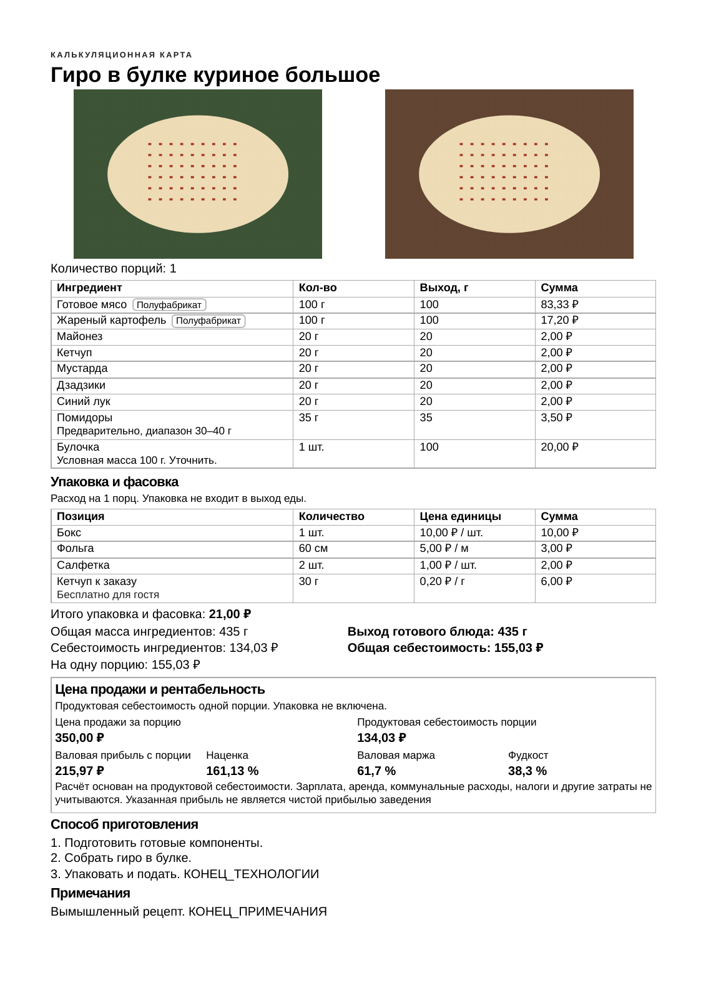
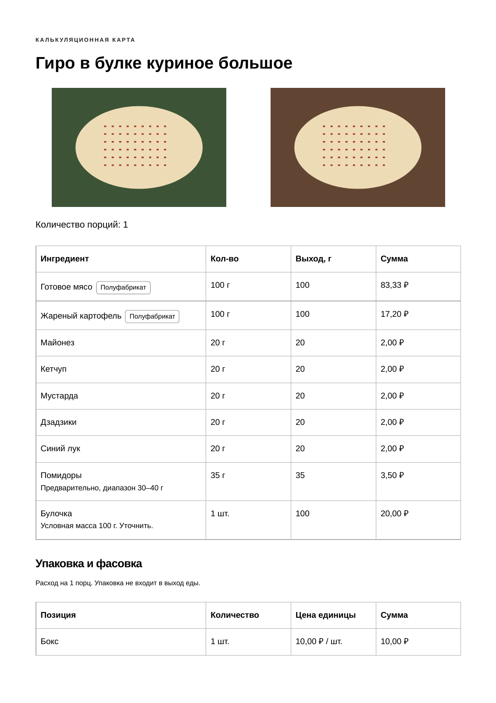
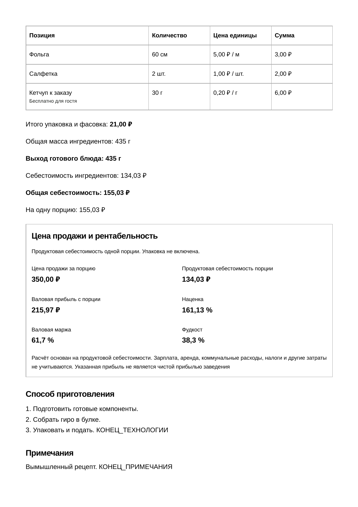

# Задание №13: компактная калькуляционная карта A4

Ветка `feature/task-13-compact-a4` создана от актуальной ветки PR №12 — `feature/task-12-selling-price`, commit `d4358aa`. PR №12 ещё открыт, поэтому этот PR сохраняет его цену продажи и показатели доходности и содержит только следующую доработку. Main, рабочий репозиторий, настройки Pages и PR №12 не меняются агентом; объединение и публикация не выполняются.

## Результат проверки гиро

Использована **тестовая копия** штатного гиро из приложения под названием **«Гиро в булке куриное большое»**: 9 ингредиентов, 4 позиции упаковки, заполненная цена продажи, три шага технологии и примечание. Цены вымышленные, изображения синтетические. Пользовательская карточка из локального браузерного хранилища не получена и не использовалась; это проверка типового состава и более объёмной упаковки, а не заявление о чтении вашей базы.

| Фотографии при печати | До | После |
| --- | --- | --- |
| Без фотографий | 2 листа | 1 лист |
| Только первая | 2 листа | 1 лист |
| Только вторая | 2 листа | 1 лист |
| Обе фотографии | 2 листа | 1 лист |

Все ингредиенты, упаковка, выход, суммы, четыре показателя доходности, обязательное финансовое примечание, технология и конец заметки видны. Проверены также координаты текста относительно границ A4.

Высота фоторамок осталась **50 мм**. Прежняя ширина, пропорции и режим полного вписывания сохранены; одиночная рамка — до 85 мм. Проверка размеров изображения в самом PDF подтверждает, что компактность не достигается уменьшением или общим масштабированием фотографий.

## Что изменилось

Только для калькуляционной карты внутри `@media print`:

- Уменьшены вертикальные отступы заголовков, абзацев, таблиц и фотоблока; поля листа остаются 15 мм.
- Основной текст — 10,5 pt, таблицы — 9,5 pt, примечания — 9 pt. Содержимое не скрывается, не сокращается и не обрезается.
- Итоги расположены в две колонки, четыре показателя доходности — в одну строку. Значения и подписи сохранены.
- Уплотнён блок доходности, включая обязательное примечание; он по-прежнему переносится целиком, если помещается на страницу.

Прежние размеры изображений, формулы, данные, шаблоны и весь браузерный JavaScript не изменены. Карта повара с печатью без финансов остаётся прежней. Четыре варианта фото сохранены.

Для длинных рецептов нет ограничения высоты или числа страниц. Заголовки таблиц повторяются; текст технологии и примечаний переносится естественно. Проверены 90 пищевых строк, 40 позиций упаковки, две фотографии и длинные тексты, а также отдельная строка с примечанием выше одной страницы — все маркеры и следующие строки сохранены.

## Сопутствующая настройка проверок

В последнем коммите PR №12 для предпросмотра добавлен `package.json` с `type: module`. Это мешало запуску всех существующих CommonJS-тестов: Node выдавал `require is not defined`. Тип пакета исправлен на `commonjs`, соответствующий текущим UMD-модулям и тестам; команда Vite и зависимости не менялись. Явный ESM-скрипт `scripts/check-preview.mjs` остаётся `.mjs`. Это настройка запуска проверок, без изменения классических браузерных скриптов или экранного интерфейса.

## Как проверить вручную

1. Откройте сохранённое блюдо и выберите **«Калькуляционная карта»**.
2. Выберите печать без фото, первой, второй или обеих фотографий.
3. Нажмите **«Печать»**. Используйте A4, масштаб 100 % и предусмотренные страницей поля. При необходимости отключите собственные колонтитулы браузера.
4. Проверьте последний ингредиент, последнюю упаковку, итоги, доходность и конец текста. Для длинной рецептуры разрешены дополнительные страницы — содержание не должно исчезать.
5. Переключите **«Карту повара»** и убедитесь, что она по-прежнему печатается без финансовых данных.

Если ваша локальная версия гиро содержит другие количества строк, длинные наименования или большой текст технологии, число страниц может отличаться. Для произвольно длинных рецептов один лист не обещается; приоритет — полные данные и читаемый шрифт.

## Образцы и доказательства

- [До: гиро с двумя фото, 2 страницы PDF](print/task-13/gyro-before.pdf).
- [После: гиро с двумя фото, 1 страница PDF](print/task-13/gyro-after.pdf).
- [После: гиро с одним фото, 1 страница PDF](print/task-13/gyro-after-one-photo.pdf).
- [Длинная рецептура, многостраничный PDF](print/task-13/long-recipe.pdf).
- [Протокол числа страниц и размеров фото](screenshots/task-13/print-proof.json).

| До: страница 1 | До: страница 2 |
| --- | --- |
|  |  |

Автоматическое сравнение экранных карточек на 320/390/1366 px дало нулевую разницу пикселей и совпадение вычисленных стилей. Растры печати карты повара совпали с прежними для всех четырёх выборов фото. Основная JSON-строка, черновики, ID и SHA-256 фотографий и переносимая резервная копия после печати не изменились.

Проверки выполнены в локальном Chromium Linux, а не на физическом принтере или Android. Собственные поля и масштабирование конкретного браузера/принтера могут влиять на число листов. Новая версия не опубликована; изменения предлагаются через отдельный PR для проверки владельцем.
