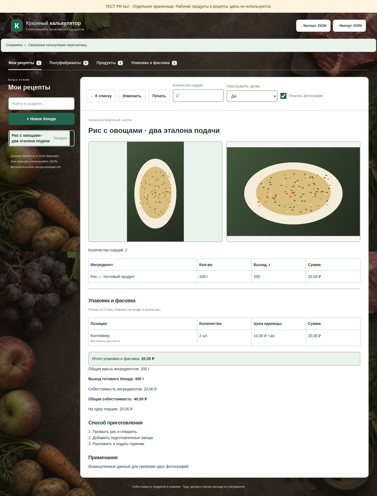
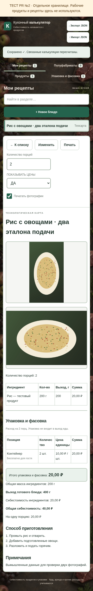
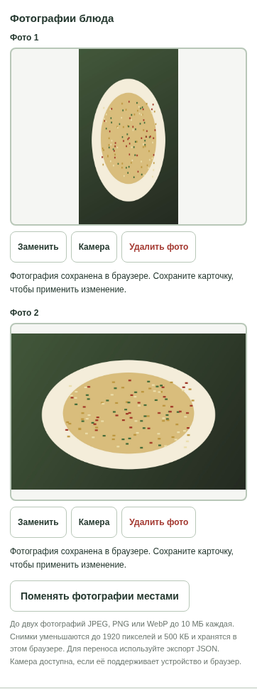
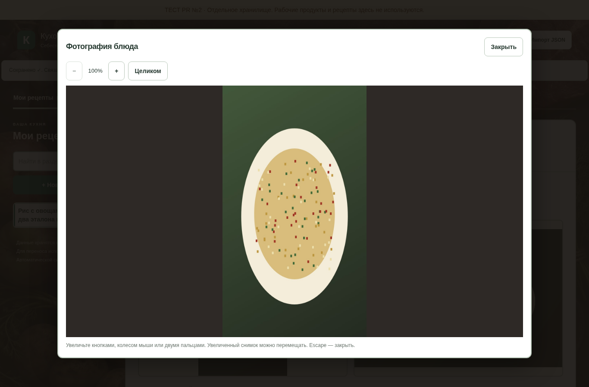
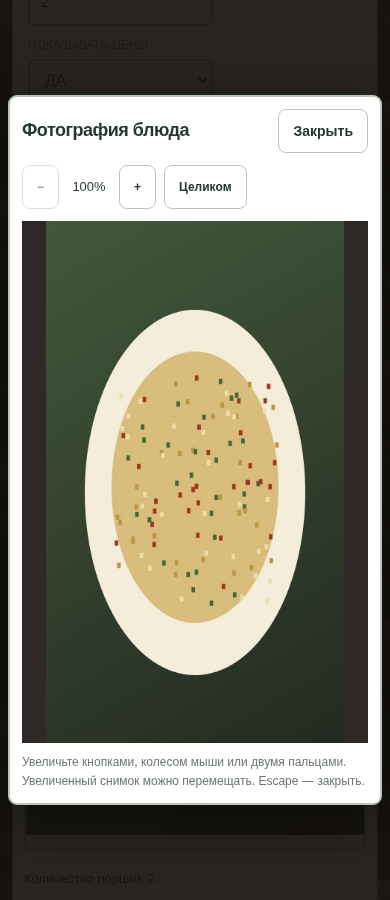

# Две фотографии — дополнение к PR №10

Продолжена существующая ветка `feature/task-8-photos-drafts` только тестового репозитория. Публикация, main, прежние PR и рабочий калькулятор не меняются. Объединение выполняет владелец после проверки.

## Короткая ручная проверка

1. Нажмите **«Изменить»** у блюда. Под названием находятся две одинаковые рамки. Нажмите рамку или **«Галерея»** и выберите снимок. На Android отдельно попробуйте **«Камера»**: откроется камера, если устройство и браузер поддерживают съёмку, иначе обычный выбор файла.
2. Добавьте второй снимок. Замените один: другой должен остаться. Нажмите **«Поменять фотографии местами»**. Удалите один с подтверждением; отмена подтверждения должна сохранить его.
3. До обычного сохранения обновите страницу и **восстановите черновик**. Оба фото, их порядок и все поля должны восстановиться. Готовая карточка пока содержит прежний рецепт.
4. Нажмите **«Сохранить»**, откройте карточку и обновите страницу. На компьютере фото рядом; на узком экране — друг под другом. Один снимок оставляет свободную вторую рамку. Фотографии вписываются целиком, без обрезки.
5. Нажмите фото. Увеличьте кнопками или колесом мыши, на телефоне попробуйте двумя пальцами. Увеличенный снимок можно перемещать. **«Целиком»** возвращает весь кадр, **«Закрыть»** или Escape закрывает просмотр. Рецепт от просмотра не меняется.
6. Проверьте печать A4 с ценами и без них, с фото и без. При включённых фото печатаются только загруженные снимки; при выключенных галерея исчезает целиком. Пустые рамки и кнопки не печатаются.
7. Экспортируйте JSON, затем импортируйте в другом тестовом браузере. Оба снимка и их порядок должны сохраниться. Отдельно импортируйте старый файл с одним фото и файл без фото.

Сначала проверяйте на вымышленных данных. Изменения в этом PR не опубликованы автоматически, поэтому прежний адрес Pages пока не показывает новую ветку.

## Выбранное качество и память

Поддерживаются JPEG, PNG и WebP, исходник до 10 МиБ и 40 Мп. Размеры проверяются по заголовку до декодирования: сверхбольшой файл не разворачивается в память. Тяжёлые исходники обрабатываются последовательно, рабочий canvas и декодированное изображение освобождаются. EXIF-ориентация JPEG учитывается браузером и закрепляется при сохранении в canvas.

На снимок выбраны **до 1920 px по длинной стороне и 500 КиБ**, без увеличения маленьких исходников. JPEG начинается с качества 0,90; используются ступени до 0,78, затем уменьшаются размеры. Сильное снижение качества ради сохранения максимального разрешения не используется. Пара снимков занимает максимум около 1 МиБ в IndexedDB; JSON с base64 будет больше.

Контрольный детализированный рисунок 3000 × 2000, одинаковый для обоих режимов:

| Политика | Результат | Размер | Сходство с исходником на общей сетке 1920 px, PSNR |
| --- | --- | --- | --- |
| Прежние 1280 px / 180 КиБ | 1280 × 853 | 140 085 байт | 28,55 dB |
| Новые 1920 px / 500 КиБ | 1920 × 1280 | 377 630 байт | 35,45 dB |

Это измерение на воспроизводимом синтетическом изображении, а не гарантия качества любой фотографии. Оно показывает, что новый предел сохраняет больше деталей при ограниченном размере файла. Исходник высокого разрешения отдельно не сохраняется. [Полные измерения](screenshots/task-8-two-photos/quality-check.json).

## Совместимость и защита

- Версия JSON 1, ключи основной базы/черновиков и имя IndexedDB сохранены. Старый `photoId` отображается в первой рамке; чтение, обычное редактирование полей и сохранение не преобразуют его автоматически.
- После действия над фото используются `photoIds: [id или null, id или null]`; переносимый JSON содержит `photos: [{dataUrl,width,height,mime} или null, ...]`. Пустая позиция не сдвигает вторую. Старые `photo` и отсутствие полей по-прежнему импортируются; более двух позиций или смешанные формы отклоняются.
- Импорт сначала подготавливает новые фотографии под свежими ID. Ошибка второй фотографии откатывает только новые записи; прежние снимки и рецепт остаются. При нехватке места новая загрузка не заменяет старую ссылку. Черновик не очищается при ошибке сохранения основной базы.
- Очистка старого фото учитывает обе позиции во всех рецептах, черновиках и текущей форме. Перестановка не удаляет ни один файл. Сохранение черновиков и формулы себестоимости не менялись.
- Максимум резервного JSON остаётся 50 МиБ; квота браузера также действует. При ошибке выводится сообщение, прежние данные сохраняются. Регулярный экспорт нужен независимо от черновиков.

## Что реально проверено

Локальный Chromium Linux: создание, две загрузки одновременно, независимая замена/удаление, перестановка, восстановление после закрытия вкладки, экспорт/импорт в новый контекст, старые однофотографические рецепты, квоты IndexedDB и основной базы, откат второго изображения, полный просмотр/масштаб/закрытие, EXIF, JPEG/PNG/WebP, сверхбольшой исходник и сохранность математических расчётов/упаковки. Размеры 320/390/768/1366 px, отсутствие горизонтального переполнения и одинаковые рамки.

Галерея и камера проверены как отдельные системные выборы файла; жест проверен через touch-события Chromium. **Физические Android-камера, галерея и жесты требуют ручной проверки на вашем телефоне.** Доступа к настоящему устройству и принтеру у агента нет; проверка на них не заявляется.

Созданы PDF четырёх сочетаний цен/фото. Список изображений в PDF подтвердил 2 фото при двух загруженных, 1 при одном и 0 при отключённой печати фото; извлечение текста подтвердило технологию и упаковку без финансовых данных в режиме повара. Скриншоты ниже сделаны локально с вымышленными данными.

| Карточка на телефоне | Управление двумя фото |
| --- | --- |
|  |  |

| Крупный просмотр на компьютере | Крупный просмотр на телефоне |
| --- | --- |
|  |  |
