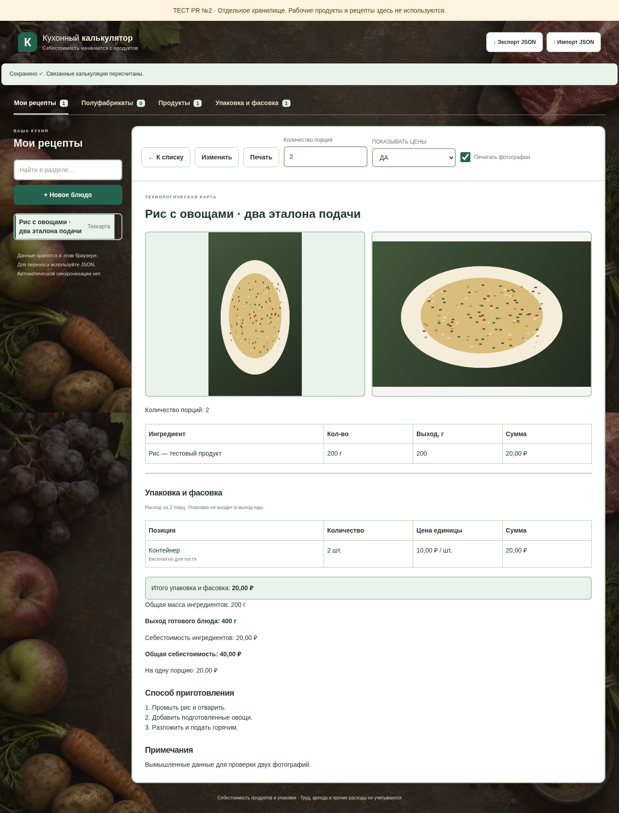
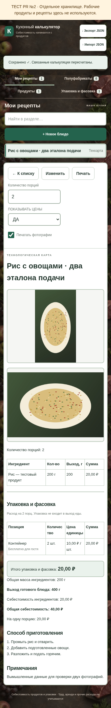
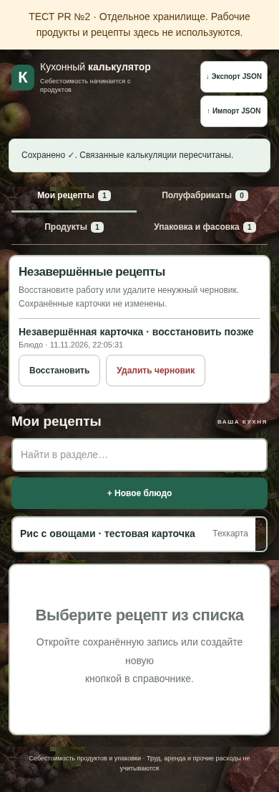

# Задание №8: фон, фотографии и незавершённые рецепты

Изменения подготовлены только для `sobaca0808-bit/kitchen-calculator-test`, в отдельной ветке `feature/task-8-photos-drafts` поверх открытого PR №9. Предыдущие функции, упаковка и фасовка сохранены. Main, настройки Pages и рабочий калькулятор не изменяются. PR не объединяется автоматически; опубликованный сайт пока не получает эти изменения.

## Что изменилось

Три направления отделены друг от друга:

- **Фон:** локальный WebP, 1536 × 1024, около 129 КиБ. Новая реалистичная генерация: виноград, яблоки, овощи, мясо, зелень и специи на приглушённом графитово-коричневом столе. Внешних запросов для фона нет. Белые рабочие карточки и поля сохранены; текст вокруг них получил светлый цвет для читаемости. Фон не печатается.
- **Фотографии:** отдельный модуль `js/photos.js`. JPEG/PNG/WebP до 10 МиБ и 40 Мп уменьшаются до длинной стороны 1920 px и максимум 500 КиБ на снимок, сохраняются как JPEG в IndexedDB. Две одинаковые рамки находятся под названием; на телефоне располагаются друг под другом. Есть галерея/камера, предварительный и крупный просмотр, независимая замена, удаление с подтверждением, перестановка и независимый флажок «Печатать фотографии».
- **Черновики:** отдельный модуль `js/drafts.js`. Снимок формы сохраняется через 400 мс после ввода и сразу при смене раздела, обновлении, закрытии вкладки или уходе приложения в фон. В снимок входят ингредиенты, сырые незавершённые числовые значения, поисковый текст, упаковка, технология, заметки, единицы, выход, порции и ссылка на фото. Незавершённый поиск сохраняется также при перестройке строк формы.

## Как проверить владельцу

1. Откройте редактор блюда, измените название, количество и технологию. Дождитесь «Черновик сохранён».
2. Обновите страницу. В блоке **«Незавершённые рецепты»** нажмите **«Восстановить»**. Сохранённая карточка пока содержит прежний рецепт.
3. Перейдите в полуфабрикаты, начните другую работу, затем вернитесь к первому черновику. Они восстанавливаются независимо.
4. Нажмите **«Сохранить»**. Карточка обновится; только её черновик исчезнет. Повторное нажатие не создаёт дубликат.
5. Загрузите две фотографии под названием. Проверьте независимую замену, удаление с подтверждением, перестановку и крупный просмотр. Сохраните блюдо и откройте карточку после обновления страницы.
6. Включите и выключите **«Печатать фотографии»**, затем показ цен. Эти настройки независимы. Откройте стандартную печать браузера A4 и проверьте четыре сочетания.
7. Экспортируйте JSON и импортируйте его в другом тестовом браузере. В копии есть фотографии сохранённых карточек. Черновики в JSON не входят: для их переноса сначала сохраните рецепт.
8. Удалите ненужный черновик. Приложение запросит подтверждение; готовый рецепт остаётся в базе.

Для проверки новых изменений через браузер сначала требуется проверка и принятие PR владельцем в тестовый репозиторий. Агент не публикует и не объединяет PR. Текущее Pages не является предпросмотром этой ветки.

## Хранение и совместимость

| Данные | Место хранения |
| --- | --- |
| Продукты, рецепты, упаковка | прежний тестовый localStorage `kitchen-calculator-pr2-browser-test-v1` |
| Незавершённые блюда/полуфабрикаты | отдельный localStorage `kitchen-calculator-pr2-browser-drafts-v1`, ключ записи — тип и ID рецепта |
| Уменьшенные фотографии | отдельная IndexedDB `kitchen-calculator-test-photos-v1`, blob и размеры |
| Резервная копия JSON | версия 1, необязательное `photos: [изображение или null, изображение или null]`; старое `photo` также поддерживается |

Сохранённая локальная карточка содержит только необязательные `photoIds`, а экспорт заменяет ссылки переносимыми изображениями в том же порядке. Старая форма `photoId`/`photo` сохраняется без автоматической миграции до изменения фотографий. Подробности двух снимков и короткая проверка — [TASK-8-TWO-PHOTOS.md](TASK-8-TWO-PHOTOS.md). Старые рецепты и JSON без фотографии проходят без добавления пустых полей и не требуют IndexedDB. Поля упаковки, коэффициенты массы и формулы не менялись.

Импорт проверяет структуру, размер, тип, сигнатуру изображения и фактические размеры после декодирования. Новые фотографии сначала записываются под свежими ID. При ошибке подготовки откатываются только эти новые записи; существующие фото и основная база остаются. Основная база заменяется одним прежним сохранением только после подготовки и подтверждения. Пока идёт импорт, форма заблокирована от нового ввода.

Ошибка записи черновика сохраняет прежний снимок. Повреждённое хранилище черновиков не перезаписывается автоматически. При ошибке записи основной базы черновик не очищается; прежние данные на диске остаются, изменения сохраняются в памяти с предупреждением и возможностью экспорта. Основной ключ не очищается, рабочий ключ не читается и не записывается. Удаляются только конкретные фотографии после явной замены/удаления и проверки отсутствия ссылок в базе, текущей форме и черновиках.

## Ограничения

- Автосохранение относится к блюдам и полуфабрикатам. Продукты и справочник упаковки сохраняются вручную с предупреждением о несохранённых изменениях.
- Черновики — локальное продолжение работы, а не резервная копия. Очистка браузера и приватный режим могут удалить данные. Облачной синхронизации нет.
- При полной недоступности хранилища или принудительном завершении процесса браузера запись гарантировать нельзя. Приложение показывает ошибки; обработка выбранного фото должна завершиться до ухода со страницы.
- HEIC, SVG и внешние URL фотографий не поддерживаются; выберите JPEG/PNG/WebP. Фотография намеренно хранится уменьшенной, без исходника высокого разрешения.
- Размер JSON ограничен 50 МиБ; один черновик — 1 МиБ, все черновики — 5 МиБ, дополнительно действует квота браузера.
- Проверки выполняются на локальном сервере в Chromium. Физический Android, другие браузеры и принтер требуют ручной приёмки. Открытие внешнего Pages из среды ограничено сетевой политикой; публикация не выполнялась.

## Снимки локальной проверки

На снимках только вымышленные данные и синтетическое изображение блюда; пользовательские фотографии не использовались.

| Карточка на телефоне | Восстановление незавершённой работы |
| --- | --- |
|  |  |
