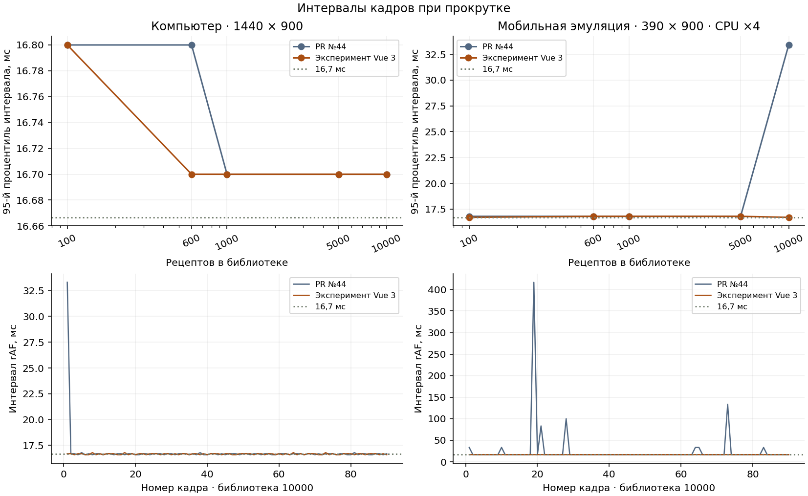
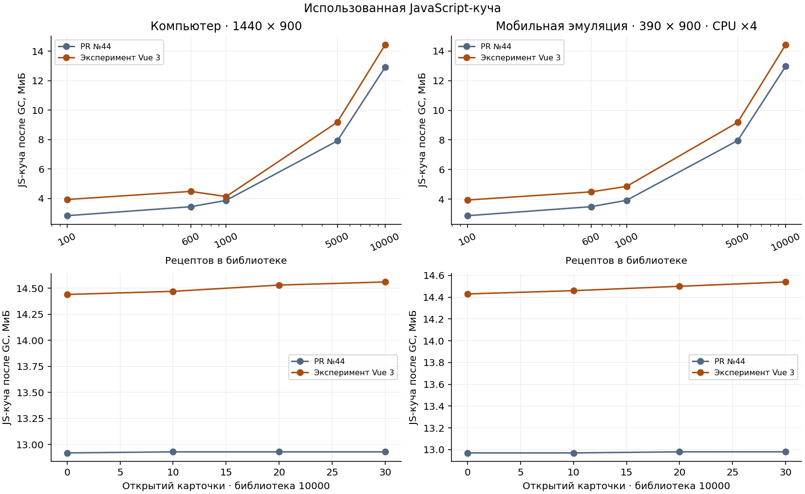

# «СИНТЕЗ МЕРЫ» на Vue 3

Эталон PR №44 — `5cac84953c47713cc8e1396be9fbf880ea933c71`. Сборка эксперимента — `75452956611dc18c627a48a422fb03a12eb83127`. Для каждого размера библиотеки обе версии прошли один и тот же сценарий в Chromium 156.0.8078.79. После каждого сохранения тест заново открыл страницу и проверил изменённое количество ингредиента и число рецептов.

[Открыть калькулятор](https://sobaca0808-bit.github.io/kitchen-calculator-test/sintez-vue/) · [Скачать веб-сборку в ZIP](https://sobaca0808-bit.github.io/kitchen-calculator-test/sintez-vue/sintez-mery-vue.zip) · [Черновой PR №45](https://github.com/sobaca0808-bit/kitchen-calculator-test/pull/45)

## Что изменилось

В эталоне один список блюд при 10 000 рецептов содержал 7 500 строк. Браузер создавал эти элементы заново при переходах между разделами. В эксперименте отрисовывается окно видимых строк с небольшим запасом. Высоту строк измеряет браузер. Индекс высот поддерживает прокрутку и клавиатурный переход к последней записи. Компоненты Vue обновляют строки по идентификатору.

Поиск повторно использует нормализованные названия, индексы ссылок и вложенности. Расчёт карточки повторно использует справочник ингредиентов. Чтение корректной базы обходится без повторного глубокого копирования и выделения отдельного массива байтов для каждой строки. Проверка целостности импорта и защита от перезаписи данных другой вкладки сохранены. Формулы стоимости и алгоритмы учёта упаковки остались в прежних модулях.

Компоненты Vue выводят рабочие режимы и меню, библиотеку, редакторы, карты рецептов, финансовый журнал, планирование, налоги, сравнение импортируемых записей, выбор оформления и диагностику хранилища. Полноэкранный просмотр фотографий загружается по запросу и доступен офлайн после подготовки PWA. При проверке обнаружили ошибки повторной привязки финансовых действий и переключения печатной формы в Vue. Оба сценария теперь входят в CI.

## Проверки

- Прошли 329 тестов Node.js и 32 проверки Python. Браузерные сценарии покрыли три рабочих режима, выбор ингредиентов с клавиатуры, черновики, снимки, редактирование, печать и 31 сценарий финансов, включая ошибки записи и три запуска браузера с одним профилем. [Результаты CI](https://github.com/sobaca0808-bit/kitchen-calculator-test/actions/runs/46048347536)
- На планшетном размере 800 px JSON с фотографией перенесён из PR №44 в эксперимент и обратно. Содержимое после обратного экспорта совпало. Проверены редактирование количества упаковки, сохранение второй фотографии, просмотр и увеличение снимка без сети, перезагрузка и запоминание темы.
- Собственный путь, идентификатор PWA, ключи данных, базы фотографий и резервных копий, имена кэшей отличают эксперимент от рабочих публикаций. При обновлении стенда проверены хеши 1 140 файлов прежних публикаций. На опубликованном адресе проверены SHA сборки и сценарии при 390 и 1440 px. [Проверка опубликованного стенда](https://github.com/sobaca0808-bit/kitchen-calculator-test/actions/runs/46048400787)
- На каждом из двух размеров экрана открыли последнюю запись библиотеки с клавиатуры, вернулись к первой и 1 000 раз открыли карточки. Ошибок JavaScript не зарегистрировано. Этот отдельный сценарий использовал библиотеку с короткими записями, без эмуляции замедления CPU. [Показания после каждых 100 открытий](session.json)

| Ширина, px | Открытий | Длительность, с | JS-куча после 100 и 1 000 открытий, МиБ | Слушателей событий после 100 и 1 000 |
|---:|---:|---:|---:|---:|
| 1440 | 1 000 | 47.5 | 6.07 → 6.49 | 136 → 136 |
| 390 | 1 000 | 22.6 | 6.08 → 6.55 | 136 → 136 |

## Ограничения и очная проверка

Синхронная запись всей книги в localStorage остаётся самой дорогой операцией на большой библиотеке. Время отклика 100 мс достигается не во всех сценариях. Для фотографий и снимков перед импортом используется IndexedDB. Предел практической вместимости зависит от длины рецептов и квоты конкретного браузера. Веб-воркеры в этой сборке не используются.

Остались адаптеры существующих модулей и нативных браузерных действий, в том числе для процедур печати, загрузки файлов, восстановления и установки PWA. На устройстве владельца предстоит проверить установку и повторный запуск без сети, работу с настоящей библиотекой и снимками камеры, прокрутку и ввод с экранной клавиатуры на HONOR, а также системный диалог A4 и печать на компьютере. Выборки JS-кучи не описывают память всего процесса. Тысяча операций не заменяет многочасовую смену.

## Сравнение интерфейса

В PR №44 закреплён Classic Dark Glass. Его экранные правила скрывают обычный переключатель тем и переопределяют часть палитры. Это унаследованное поведение сохранено. Для проверки трёх сохранённых значений сценарий вызывает штатный модуль оформления; снимки главного экрана поэтому могут выглядеть одинаково при разных значениях.

| Экран | PR №44 | Vue 3 |
|---|---|---|
| Телефон, графит | [До](pr44-390-graphite.png) | [После](vue-390-graphite.png) |
| Телефон, шалфей | [До](pr44-390-sage.png) | [После](vue-390-sage.png) |
| Телефон, ягодная кухня | [До](pr44-390-berry.png) | [После](vue-390-berry.png) |
| Компьютер, графит | [До](pr44-1440-graphite.png) | [После](vue-1440-graphite.png) |

[Карта повара на телефоне](390-chef-card.png) · [Библиотека на компьютере](1440-recipes.png) · [Настройки](390-settings.png)

[Исходные замеры PR №44](before.json) · [Исходные замеры Vue 3](after.json)

## Методика

Каждая комбинация размера и устройства использует отдельный пустой профиль браузера. Синтетическая библиотека содержит указанное общее число рецептов, примерно четверть составляют полуфабрикаты. У добавленного рецепта один ингредиент. В трёх начальных рецептах есть в том числе вложенный полуфабрикат и несколько ингредиентов. Пакеты загружены с локального HTTP, кэш браузера холодный, service worker заблокирован для сравнимости. Заполнение базы исключено из времени открытия. Измерение первоначального запуска включает переход к библиотеке, появление ряда и два кадра.

Время действий измерено в странице между вызовом действия и вторым requestAnimationFrame. Это приближение к визуальному отклику, без физического дисплея. Для поиска, фильтра, открытия, редактирования и переключения приведена медиана трёх действий, для сохранения — одно измерение с проверкой изменённого значения после перезагрузки. Переключение измеряет полный цикл «рецепты → заготовки».

90 кадров прокрутки с шагом 64 пикселя измеряются через rAF. Для библиотеки в 100 записей прокрутка доходит до конца раньше. Длинная задача — запись PerformanceObserver (≥ 50 мс). Память измерена через CDP после принудительной сборки мусора. Единицы — МиБ занятой JS-кучи, без памяти GPU и всего процесса. Повторный сценарий открывает две карточки поочерёдно 30 раз. Один прогон на ячейку и эмуляция CPU характеризуют стенд, многочасовую работу и физический HONOR следует оценить отдельно.

## Компьютер · 1440 × 900

| Рецептов | Загрузка, мс | Поиск, мс | Папка, мс | Карточка, мс | Разделы, мс | Ингредиент, мс | Сохранение, мс |
|---:|---:|---:|---:|---:|---:|---:|---:|
| 100 | 579 → 642.1 | 33.4 → 33.2 | 36.9 → 36.9 | 34.9 → 38.3 | 84.7 → 109.2 | 33.3 → 33.3 | 64.6 → 62.3 |
| 600 | 567.4 → 511.2 | 50.1 → 38.2 | 38.6 → 39.5 | 41 → 42.2 | 154.9 → 103.9 | 39.9 → 49.9 | 267.6 → 59.7 |
| 1000 | 463.5 → 539.7 | 44 → 36.6 | 38.4 → 38.7 | 40 → 39.6 | 160.2 → 76.2 | 33.9 → 33.4 | 396.1 → 58.5 |
| 5000 | 1054.3 → 403.8 | 32.6 → 37.6 | 33.9 → 39.5 | 71.1 → 76.7 | 352.7 → 103 | 37.4 → 33.2 | 1579.6 → 338.7 |
| 10000 | 1364.6 → 375.1 | 49.2 → 42.5 | 63.2 → 36.5 | 58.3 → 48.4 | 690 → 93.9 | 50.3 → 65.9 | 1976.9 → 173.5 |

| Рецептов | rAF, кадр/с | p95 кадра, мс | Кадров >32 мс / 90 | Макс. длинная задача, мс | Строк в DOM | Куча после 30 открытий, МиБ |
|---:|---:|---:|---:|---:|---:|---:|
| 100 | 60 → 60 | 16.8 → 16.8 | 0 → 0 | 66 → 139 | 75 → 15 | 2.85 → 4.04 |
| 600 | 59.3 → 60 | 16.8 → 16.7 | 1 → 0 | 215 → 70 | 450 → 15 | 3.47 → 4.6 |
| 1000 | 59.3 → 60 | 16.7 → 16.7 | 1 → 0 | 356 → 86 | 750 → 15 | 3.88 → 4.24 |
| 5000 | 60 → 59.3 | 16.7 → 16.7 | 0 → 1 | 1543 → 265 | 3750 → 15 | 7.92 → 9.29 |
| 10000 | 59.3 → 60 | 16.7 → 16.7 | 1 → 0 | 1926 → 149 | 7500 → 15 | 12.93 → 14.56 |

## Мобильная эмуляция · 390 × 900 · CPU ×4

| Рецептов | Загрузка, мс | Поиск, мс | Папка, мс | Карточка, мс | Разделы, мс | Ингредиент, мс | Сохранение, мс |
|---:|---:|---:|---:|---:|---:|---:|---:|
| 100 | 1295.8 → 1015.7 | 37.6 → 35 | 45.5 → 38.9 | 113.6 → 116.9 | 244.7 → 253.3 | 50.6 → 72.7 | 199.8 → 122.5 |
| 600 | 1276.5 → 1020.4 | 50.8 → 33.6 | 58 → 46.8 | 88.8 → 86.4 | 469.6 → 241.8 | 52.8 → 50.1 | 1034.3 → 141.1 |
| 1000 | 1558 → 955.9 | 71.4 → 36.9 | 53.1 → 50.5 | 140.6 → 121.1 | 594.1 → 319.6 | 59.9 → 55.2 | 1670.5 → 179.5 |
| 5000 | 3989.9 → 905.7 | 91.8 → 37.2 | 156.3 → 48.3 | 151.8 → 88.5 | 1024 → 257.9 | 74.3 → 66.6 | 7227.4 → 782.4 |
| 10000 | 6225.5 → 1078.1 | 156.3 → 37.7 | 209.3 → 46.4 | 161.1 → 117.8 | 2195.6 → 239.5 | 108.5 → 88.7 | 14059.7 → 679 |

| Рецептов | rAF, кадр/с | p95 кадра, мс | Кадров >32 мс / 90 | Макс. длинная задача, мс | Строк в DOM | Куча после 30 открытий, МиБ |
|---:|---:|---:|---:|---:|---:|---:|
| 100 | 56.3 → 59.3 | 16.8 → 16.7 | 2 → 1 | 188 → 184 | 75 → 12 | 2.9 → 4.06 |
| 600 | 56.8 → 59.3 | 16.8 → 16.8 | 2 → 1 | 1014 → 210 | 450 → 12 | 3.51 → 4.6 |
| 1000 | 58.7 → 59.3 | 16.8 → 16.8 | 1 → 1 | 1641 → 200 | 750 → 12 | 3.93 → 4.97 |
| 5000 | 58.7 → 60 | 16.8 → 16.8 | 2 → 0 | 7195 → 729 | 3750 → 12 | 7.97 → 9.3 |
| 10000 | 40 → 60 | 33.4 → 16.7 | 9 → 0 | 13983 → 660 | 7500 → 12 | 12.98 → 14.54 |
