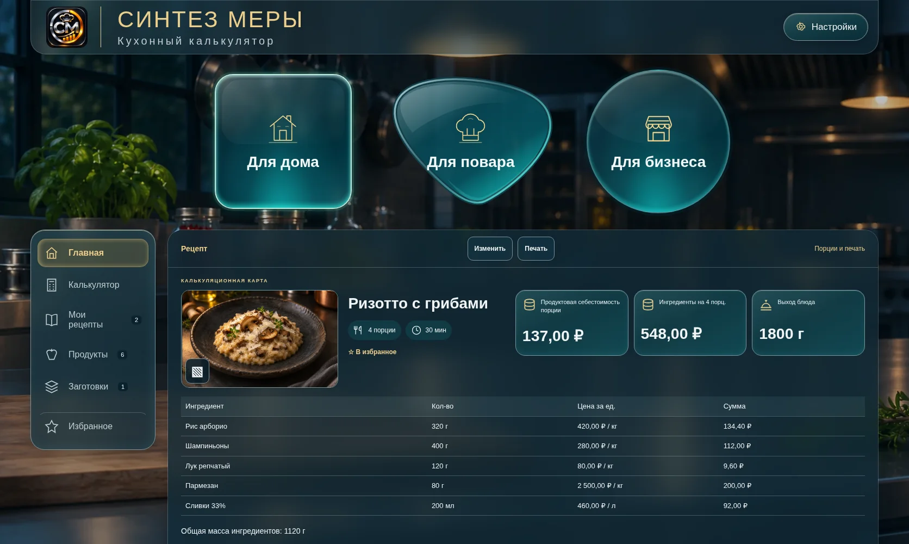
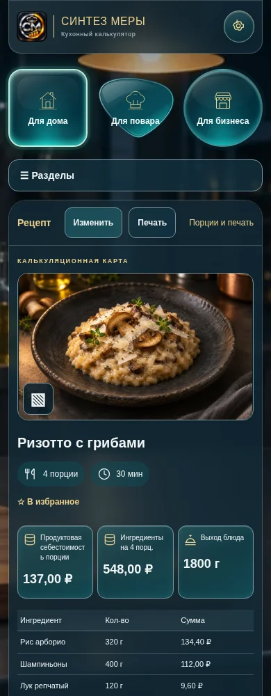

# СИНТЕЗ МЕРЫ — единое рабочее пространство

**Открыть работающий тест:** https://sobaca0808-bit.github.io/kitchen-calculator-test/sintez-workspace/

**PR для проверки:** https://github.com/sobaca0808-bit/kitchen-calculator-test/pull/37

Исходный коммит: `cbf42009a0001bc3e91c6d305ebe302bcc2f3382`.

## Что получилось

Сохранена одна программа и одна существующая SINTEZ-тестовая база. По утверждённому изображению с ризотто собраны тёмный кухонный фон, бирюзовое стекло, золотистые детали, постоянная шапка и три большие кнопки режимов. В шапке — оригинальный фирменный логотип из проекта; условные весы не используются.

Слева расположено рабочее меню, по центру — настоящие прежние списки, редакторы и карточки. При смене режима редактор не заменяется другим приложением и страница не перезагружается.

- **Для дома:** главная, калькулятор, рецепты, продукты, заготовки, избранное, фотографии.
- **Для повара:** предыдущие функции плюс технологические карты, обработка/потери, порции и себестоимость.
- **Для бизнеса:** предыдущие функции плюс упаковка, расходы, продажные цены и финансовые показатели.

Фото блюда находится слева, название и компактные порции/время — рядом, реальные показатели — справа. На телефоне фото размещается над остальными блоками, меню открывается кнопкой «Разделы».

Новое время приготовления сохраняется в той же записи рецепта, черновике и JSON. Старое отсутствующее время показано как «Время не задано». Избранное — флаг записи, без копирования блюда. Две фотографии, выбор основного снимка, увеличение и прежние варианты печати сохранены во всех режимах.

Настройки содержат настоящие прежние кнопки JSON и диагностики. Нижняя панель показывает версию из package.json, точный коммит и реальную дату сборки. Информационные кнопки работают; закрытие информационного окна не выводит из настроек.

## Скриншоты настоящего HTTPS-стенда

Учебные данные и фото созданы только в одноразовых профилях проверки. Они **не добавляются** в вашу базу и не входят в опубликованный пакет.

| Режим | Компьютер, 1672 px | Телефон, 390 px |
| --- | --- | --- |
| Для дома | [Полный экран](evidence/home-1672.webp) | [Полный экран](evidence/home-390.webp) |
| Для повара | [Полный экран](evidence/chef-1672.webp) | [Полный экран](evidence/chef-390.webp) |
| Для бизнеса | [Полный экран](evidence/business-1672.webp) | [Полный экран](evidence/business-390.webp) |

[Редактор 320 px](evidence/editor-320.webp) · [Планшет 768 px](evidence/editor-768.webp) · [Редактор 1024 px](evidence/editor-1024.webp)

В отличие от демонстрационных сумм рекламного изображения, здесь используются результаты настоящего движка: ингредиенты 548 ₽, упаковка 15,60 ₽ и расходы 296 ₽ на четыре порции. Полная расчётная себестоимость — 859,60 ₽. Продуктовая стоимость порции — 137 ₽. Сохранённая продажная цена — 420 ₽; рекомендованную цену программа не выдумывает.

## Проверки

[Полный CI исходного коммита](https://github.com/sobaca0808-bit/kitchen-calculator-test/actions/runs/44364114421).

- 253 прежних теста логики и 24 проверки оформления, проекций и режимов — пройдены.
- Все 655 прежних функциональных браузерных сценариев — пройдены, включая 25 проверок расходов и 21 проверку сохранения/восстановления.
- Шесть сочетаний темы и размера экрана прошли по три полных запуска Chrome: после каждого проверены записи, цены, обе фотографии, черновик и реальное скачивание JSON.
- 25 новых сценариев единого интерфейса — пройдены.
- 12 проверок сборки, хранилищ, кеша и иконок; 6 проверок строгого verifier — пройдены.
- По 4 сценария настоящей установки PWA, офлайн и безопасного обновления в Chrome Windows и Linux — пройдены.
- В восьми сочетаниях печати совпали слова, координаты и пиксели A4 с PR №36.

[Публикация и проверка настоящего HTTPS](https://github.com/sobaca0808-bit/kitchen-calculator-test/actions/runs/44364169499).

Все **25 сценариев** прошли на настоящей опубликованной HTTPS-странице, без подмены JS/CSS. Проверены три режима, создание и сохранение записей, фотографии, старые базы, время, избранное, черновики, JSON, мобильные размеры и A4. Ошибок JavaScript и обращений к рабочему хранилищу не обнаружено.

Сверены **594 прежних + 74 новых = 668 HTTPS-ресурсов**. Все **847 прежних статических файлов** сохранились побайтно.

Старые проверки внешнего положения фото и столбцов обновлены под явно согласованную компоновку. Проверки цен, формул, хранения, качества фото и JSON сохранены. Адаптер прежних функциональных сценариев только нажимает настоящие настройки/меню/раскрытия и отвечает на новые предупреждения при отсутствии явного обработчика теста; CSS, JS, данные и видимость он не подменяет. Новая UI-проверка работает без этого адаптера.

Цветовые пары новых показателей и нижней панели проверены отдельно в трёх темах: 9 случаев, минимальный расчётный контраст 5,56:1 на консервативном светлом фоне. [Результат](evidence/contrast-proof.json). Это проверка перечисленных блоков, а не заявление о сертификации всего приложения.

## Печать A4

Для старого рецепта без нового времени сравнение с точным PR №36 прошло во всех восьми сочетаниях: **совпали слова, координаты и пиксели**. Экранная витрина, меню и нижняя панель не печатаются. Размеры фото и прежние финансовые режимы сохранены. Длинные таблицы проверены прежними функциональными сценариями.

| Фотографии | Калькуляционная карта | Карта повара |
| --- | --- | --- |
| Нет | [PDF](evidence/calculation-none.pdf) | [PDF](evidence/chef-none.pdf) |
| Первая | [PDF](evidence/calculation-first.pdf) | [PDF](evidence/chef-first.pdf) |
| Вторая | [PDF](evidence/calculation-second.pdf) | [PDF](evidence/chef-second.pdf) |
| Обе | [PDF](evidence/calculation-both.pdf) | [PDF](evidence/chef-both.pdf) |

## Сохранность и публикация

- Main остаётся `9f45d0206022d5cfb66352b5a1518b3ff9a50abc`.
- PR №36 остаётся открытым и неизменённым на `a71c0bf0f285d82e315b9146224bb8250d564268`. PR №37 основан на его ветке; дальнейший порядок объединения решает владелец.
- 74 прежних файла и 18 обработчиков App защищены guard-проверкой. Формулы, JSON, хранение, фото и PWA-клиент/worker не переписывались. Оригинальный логотип сохранён побайтно.
- Новых пространств хранения нет. Используются прежние SINTEZ-тестовые book/drafts/photos/backups/appearance. База общая с прежними SINTEZ-стендами, рабочая база автоматически не переносится.
- Добавлен только `/sintez-workspace/` с отдельными manifest id/scope. Пакет содержит 72 офлайн-ресурса. Прежние установленные PWA не заменяются.
- Перед публикацией проверены 594 старых HTTPS-ресурса; после — все 668, включая 74 новых. 847 прежних статических файлов сохранены побайтно. Настройки Pages не менялись.

[Проверка сохранности публикации](evidence/publication-proof.json) · [Браузерные сценарии](evidence/unified-proof.json) · [Описание реализации](https://github.com/sobaca0808-bit/kitchen-calculator-test/blob/feature/sintez-unified-workspace/docs/UNIFIED-WORKSPACE.md)

## Что остаётся для следующих этапов

Новые сложные модули расширенной аналитики не имитировались: соответствующие инструменты открывают существующие расчёты. Внешний сервис приёма обращений не подключён; «Обратная связь» позволяет написать и скопировать текст и явно сообщает об этом.

В локальном тестовом окружении системный Chromium 154 аварийно завершался с SIGTRAP при повторном скачивании JSON. На GitHub тот же полный сценарий с реальными скачиваниями после каждого запуска прошёл в обычном Google Chrome. Изменений в данных или алгоритме экспорта ради обхода этого сбоя не делалось.

Проверки телефона автоматизированы в мобильных размерах Chromium. Физический Android, камера устройства, жесты/установка на вашем телефоне и окончательная оценка дизайна требуют ручной проверки владельцем.

## Короткая ручная проверка

1. Сначала открыть настройки и сохранить JSON. Не очищать браузерное хранилище и не удалять старое приложение.
2. Открыть новый тестовый адрес на телефоне и ПК. Переключить три режима: шапка остаётся, инструменты расширяются.
3. Создать/изменить продукт, заготовку и рецепт. Указать порции, время и две фотографии, сохранить. Закрыть и снова открыть приложение.
4. Начать изменение рецепта, переключить режим, проверить предупреждение и сохранность полей. Обновить страницу и восстановить черновик.
5. Проверить избранное, упаковку, продуктовую стоимость и отдельные расходы в бизнес-режиме.
6. Экспортировать/импортировать JSON, проверить время и фотографии. Раскрыть «Порции и печать», проверить обе формы и варианты снимков на A4.
7. Открыть Помощь/О программе/Обратную связь, проверить меню и длинную форму на телефоне.

Ничего не объединено с main и не выпущено по основному адресу. Следующий шаг — ручная приёмка PR №37; любое объединение и основной выпуск требуют отдельного решения владельца.
